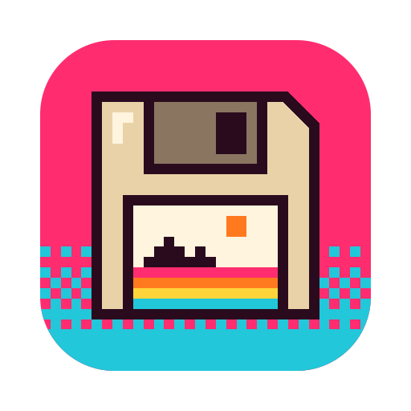

<p align="center"></p>

# BestImage: Score and Sort Images by Aesthetics

<p></p>

*Filed under: Photography*

BestImage is a native macOS drag-and-drop utility that sorts image files by Apple Vision's image-aesthetics score.

Apple put a model in Vision that will tell you, on a scale from -1 to 1, how good it thinks a picture looks. BestImage asks it about every image you drop in and writes the answer into the filename, so Finder can do the sorting. I should mention two things up front: it renames your original files, and it's source only, so you'll need macOS 15 and Xcode 16 to build it. The scores are Apple's opinion. We wouldn't dare have one.

## What it does

- Scores each image on your Mac with Apple Vision. Nothing is uploaded.
- Renames the original file so that sorting by name puts the highest scores first.
- Re-scoring an image it already renamed replaces the old prefix instead of adding another.
- Puts the original names back with one click.
- Crops images in a separate **Crop** section, which never scores or renames anything:
  - Auto-Detect fits the crop to the subject on a white or transparent background.
  - Cut out background removes a white or transparent background and its drop shadow.
  - Split into separate images saves each item on a sheet, such as several posters in one scan, as its own image.
  - Find Trims suggests border trims using ImageMagick, if it's installed.

## What it doesn't do yet

- It renames files in place. It doesn't copy them first.
- **Restore Original Names** only works while the files are still listed in the window. After that, each original name is still in its filename, after the `__`.
- Scoring doesn't move, delete or edit the pictures themselves. Cropping saves new PNG files next to the original (`-crop`, `-cutout`, numbered when split) and leaves the original alone.
- Find Trims doesn't work without ImageMagick.
- The score is Vision's single number. It knows nothing about who's in the photo or why you kept it.

## Use

1. Drop image files into the window, or click **Choose Images**.
2. BestImage scores each image and renames it in place.
3. In Finder, sort by **Name** descending. The highest scores come first.
4. To undo, click **Restore Original Names** while the files are still listed in the window.

### Crop

1. Click **Crop** in the switch at the top of the window.
2. Drop image files into the window, or click **Choose Images…**.
3. Click **Crop…** next to an image.
4. Adjust the crop, then click **Save Copy** (or **Save N Copies** when splitting). The new image is added to the list.

### Filename format

`1.742_score+0.742__IMG_0042.jpg`

- `1.742` is the sign-safe sort value (Vision score plus 1).
- `+0.742` is the actual Apple Vision score.
- `IMG_0042.jpg` is the original filename.
- A collision adds `__2`, `__3`, and so on immediately before the extension.

The sort value is needed because macOS filename sorting does not order negative decimal text numerically. Scores are clamped to Vision's `-1...1` range for naming.

## Requirements

- macOS 15 or later
- Xcode 16 or later
- Optional: [ImageMagick](https://imagemagick.org), for **Find Trims** (`brew install imagemagick`)

## Build

Open `BestImage.xcodeproj` in Xcode and run, or from Terminal:

```bash
xcodebuild -project BestImage.xcodeproj -scheme BestImage -configuration Release build
```

The project uses ad hoc signing, so no Apple developer account is needed. No prebuilt binaries are published.

## Versioning

BestImage uses [Semantic Versioning](https://semver.org/spec/v2.0.0.html). Changes are listed in [CHANGELOG.md](CHANGELOG.md).

## How to help

If a score, a rename or a restore does something you didn't expect, please open an issue on this repository and say what you dropped in and what you saw. We don't take pull requests, so an issue is the way in. We'd rather know.

## Credits and thanks

- The scoring is Apple's: the image-aesthetics request in the [Vision](https://developer.apple.com/documentation/vision) framework.
- Find Trims runs [ImageMagick](https://imagemagick.org) if you have it. It isn't bundled.
- This app was written mostly with Claude, with some consulting from ChatGPT and occasional help from Gemini or an on-device Qwen model. No Grok was used.
- The icon's SVG masters are in `.github/brand/`.

## Licence

N©! Big Shame Software 2026. Public domain, via [the Unlicense](LICENSE).

a Big Shame Software app
