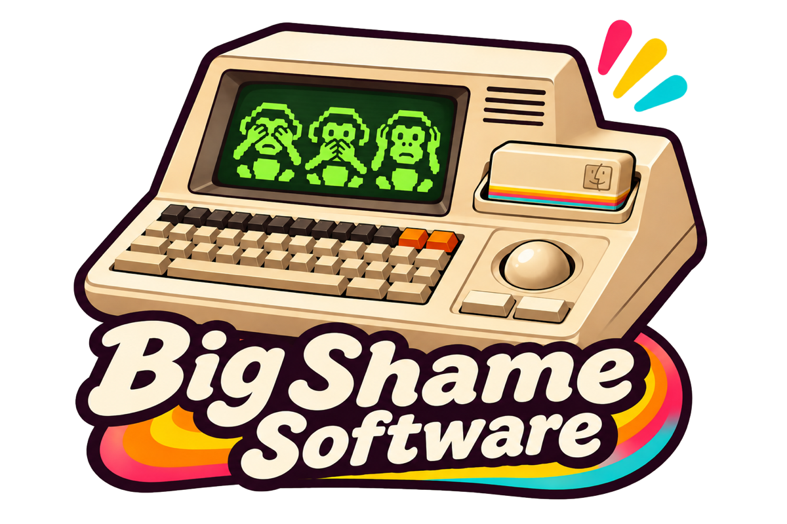

<p align="center"></p>

# BestImage

BestImage is a native macOS drag-and-drop utility for sorting image files by Apple Vision's image-aesthetics score.

## Use

1. Drop image files into the window, or click **Choose Images**.
2. BestImage scores each image on your Mac with Apple Vision.
3. The original files are renamed in place.
4. In Finder, sort by **Name** descending to put the highest scores first.
5. To undo, click **Restore Original Names** while the files are still listed in the window.

## Filename format

`1.742_score+0.742__IMG_0042.jpg`

- `1.742` is the sign-safe sort value (Vision score plus 1).
- `+0.742` is the actual Apple Vision score.
- `IMG_0042.jpg` is the original filename.
- A collision adds `__2`, `__3`, and so on immediately before the extension.
- Dropping an already scored image replaces the managed prefix instead of adding another prefix.

The sort value is required because macOS filename sorting does not order negative decimal text numerically. Scores are clamped to Vision's `-1...1` range for naming.

## Requirements

- macOS 15 or later
- Xcode 16 or later

## Build

Open `BestImage.xcodeproj` in Xcode and run, or from Terminal:

```bash
xcodebuild -project BestImage.xcodeproj -scheme BestImage -configuration Release build
```

The project uses ad-hoc signing, so no Apple developer account is needed. No prebuilt binaries are published.

## How it was made

This app was written mostly with Claude, with some consulting from ChatGPT and occasional help from Gemini or an on-device Qwen model. No Grok was used.

## Licence

Public domain, via [the Unlicense](LICENSE). A Big Shame Software release.
